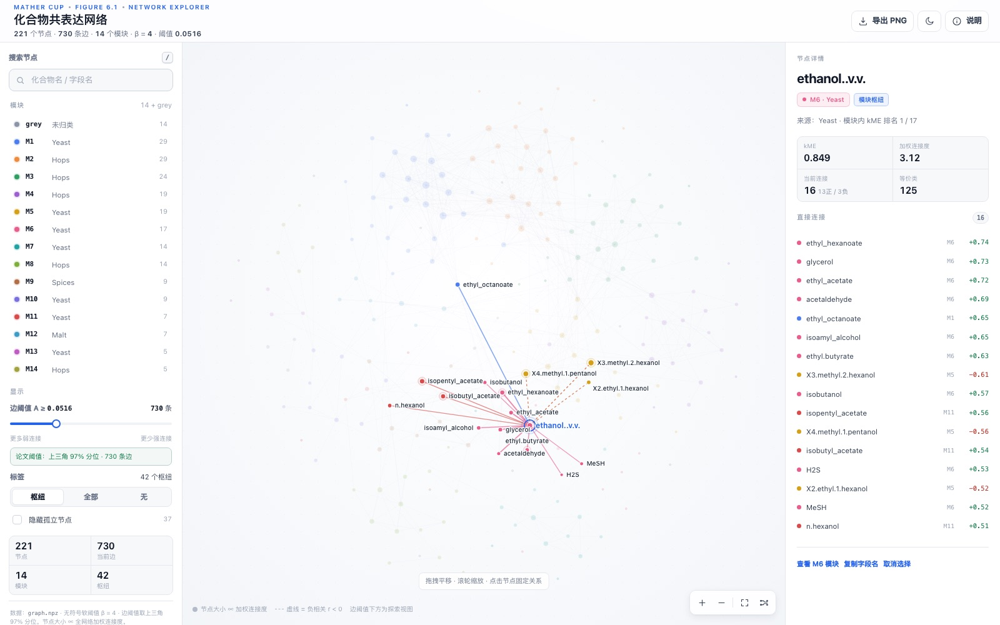

# 图 6.1 · 化合物共表达网络（交互版）

论文图 6.1「化合物共表达网络」的可交互版本。单文件 HTML，数据全部内嵌，无外部依赖，可直接在浏览器中打开。

**在线访问：** https://yueci123123-png.github.io/figure-6-1-network/

## 交互

- **悬停节点**：高亮它的直接邻居，显示化合物名、模块、kME 与加权连接度。
- **点击节点**：固定选择；右侧面板列出直接邻居、Spearman *r* 与 kME，继续点击邻居可沿关系跳转。
- **搜索**：按化合物名或字段名查找节点。
- **模块**：点击左侧模块聚焦，查看模块规模、内部边与跨模块边。
- **边阈值**：拖动滑块查看更弱或更强的连接；低于论文阈值时为探索视图。
- **其他**：明/暗主题、导出当前视图 PNG、下载节点/边 CSV、深链参数 `?node=30`、`?module=1`、`?theme=dark`。

## 数据与口径

| 项目 | 值 |
|---|---|
| 节点 | 221（14 个模块 + 14 个灰色未归类节点） |
| 边 | 730 条无向边（论文阈值 `A ≥ 0.05155079878999882`，上三角 97% 分位） |
| 边权重 | `A = |Spearman r|⁴`，β = 4，无符号 |
| 模块枢纽 | 42 |
| 论文阈值下孤立节点 | 37（其中 16 条边的 *r* < 0，页面以虚线显示） |

节点大小 ∝ 全网络加权连接度（`A` 的行和），不是筛选后的边数；kME 表示节点与所在模块特征基因的相关性。

## 阅读说明

- 网页使用力导向重新布局，节点位置与论文原图的 NetworkX `spring_layout` 不同；节点集合、边集合、模块划分、kME、等价类与阈值保持一致。
- 模块配色为屏幕可读性做了调整，模块编号与原图一致。
- 边阈值低于论文的 `0.05155` 时，会显示原图未绘制的弱相关，仅用于探索，不应作为论文图的复现。
- 节点包含香气化合物及少量化学/感官指标（如 `bitterness`、`iron`）。

## 数据来源

节点、模块、kME、等价类与完整邻接矩阵来自论文分析缓存 `result/problem2/cache/graph.npz` 与 `Q2_modules.csv`；边表由 `A` 的上三角按阈值导出。网页内嵌全部节点与绘制边数据（另含 `A ≥ 0.015` 的探索边），离线可用。

## 本地打开

直接双击 `index.html`，或在目录中启动任意静态文件服务器。页面不依赖网络。

## 部署

GitHub Pages：`Settings → Pages → Deploy from a branch`，选择 `main` 分支的 `/ (root)`。仓库根目录的 `index.html` 即为入口。
